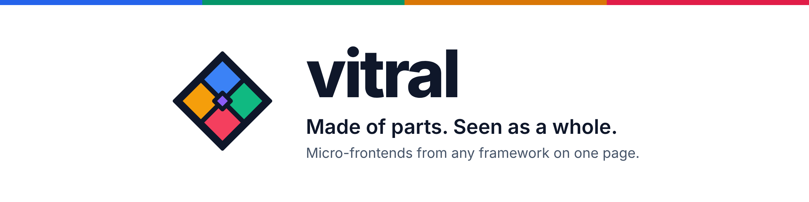
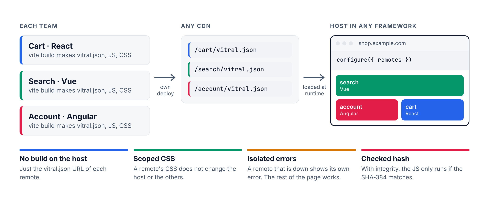
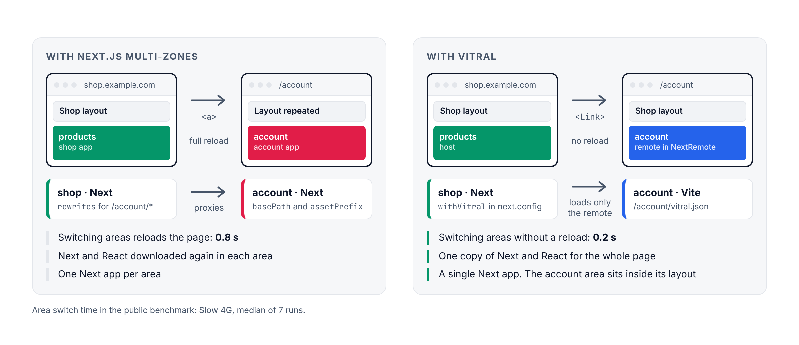
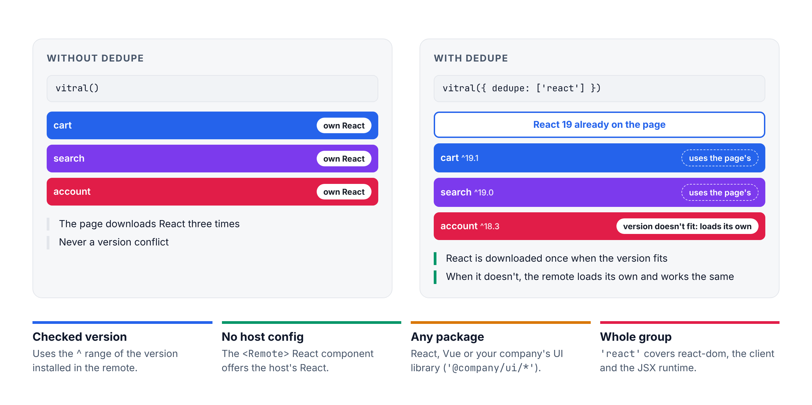
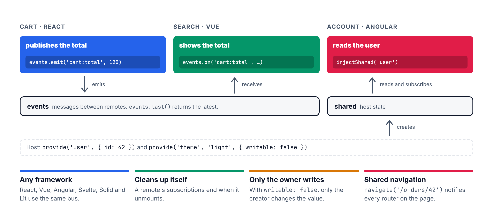
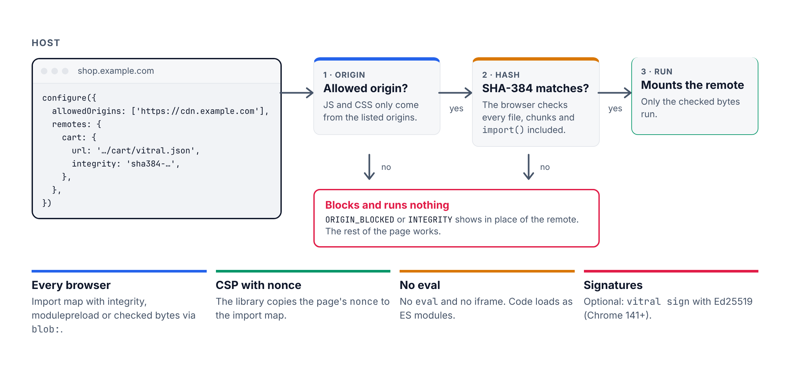

<p align="center">
  <picture>
    <source media="(prefers-color-scheme: dark)" srcset="https://raw.githubusercontent.com/joaogabriel15/vitral/main/docs/public/marca/banner-escuro-en.png">
    
  </picture>
</p>

<p align="center"><strong>Micro-frontends from any framework on one page. No build config on the host.</strong></p>

<p align="center">
  <a href="https://www.npmjs.com/package/vitral"></a>
  <a href="https://github.com/joaogabriel15/vitral/blob/main/LICENSE"></a>
  · <a href="./README.md">Português</a>
</p>

Each team ships its own part of the page (a remote) with `vite build`. The host gets the URL of each remote and mounts them in the browser. No plugin on the host, no React version to agree on between teams, and a remote that is down does not take the page down.

**Why use it:**

- **Any framework, both ways:** React, Next, Vue, Nuxt, Angular, Svelte, Solid, Preact, Lit and plain JS. Host and remote do not need to match.
- **Scoped CSS:** a remote's CSS (Tailwind included) only applies inside that remote. Shadow DOM is one prop away.
- **Isolated errors:** each remote shows its own error and can be retried alone.
- **Integrity:** with a SHA-384 hash, the remote's JS only runs if the hash matches.
- **Typed props:** the build publishes `vitral.d.ts`; `npx vitral types` makes a wrong prop fail to compile on the host.
- **Shared state and events** across remotes, keep-alive, lazy loading, prefetch, canary and rollback.

```bash
npm install vitral
```

<p align="center">
  <picture>
    <source media="(prefers-color-scheme: dark)" srcset="https://raw.githubusercontent.com/joaogabriel15/vitral/main/docs/public/marca/como-funciona-escuro-en.png">
    
  </picture>
</p>

## Quick start

`npm create vitral@latest` scaffolds a host and a remote.

**Remote:** export your component and add the plugin.

```js
// vite.config.js
import react from '@vitejs/plugin-react'
import vitral from 'vitral/vite'

export default { plugins: [react(), vitral()] }
```

`vite build` outputs the JS, the CSS and a `vitral.json`. Deploy `dist` to any CDN with CORS.

**Host:** register the URL and render.

```jsx
import { configure } from 'vitral'
import { Remote } from 'vitral/react'

configure({ remotes: { cart: 'https://cdn.example.com/cart/vitral.json' } })

export const App = () => <Remote name="cart" props={{ userId: 42 }} fallback={<p>Loading…</p>} />
```

No build at all, in any HTML page:

```html
<script type="module" src="https://cdn.jsdelivr.net/npm/vitral/dist/auto.js"></script>
<vitral-remote src="https://cdn.example.com/cart/vitral.json"></vitral-remote>
```

## Speed

Measured in Chromium on a slow mobile network (Slow 4G). Median of 7 visits. Lower is better.

**Against Module Federation**, with React shared between remotes:

| | vitral | Module Federation |
|---|--:|--:|
| Open the page with 1 remote | **1.1 s** | 2.6 s |
| Open the page with 8 remotes | **2.1 s** | 4.5 s |
| Downloaded with 8 remotes | **153 kB** | 409 kB |

**Against Next.js Multi-Zones**, with the app split into two areas:

| | vitral | Multi-Zones |
|---|--:|--:|
| Open the first area | **0.7 s** | 1.0 s |
| Switch areas | **0.2 s** | 0.8 s |
| Downloaded to open both areas | **83 kB** | 229 kB |

The minimal host code is 5.1 kB with brotli. [How it was measured](https://joaogabriel15.github.io/vitral/aprender/benchmark): versions, machine and the script to run it again.

## Next.js and Nuxt as host

The remote is always a Vite project (React, Vue or another), as in the quick start above. The host can be a Next or Nuxt app.

**Next.js (App Router):**

```tsx
// app/cart.tsx
'use client'
import { configure } from 'vitral'
import { Remote } from 'vitral/react'

if (typeof window !== 'undefined') {
  configure({ remotes: { cart: 'https://cdn.example.com/cart/vitral.json' } })
}

export function Cart({ userId }: { userId: number }) {
  return <Remote name="cart" props={{ userId }} fallback={<p>Loading…</p>} />
}
```

```tsx
// app/page.tsx
import { Cart } from './cart'

export default function Page() {
  return <main><Cart userId={42} /></main>
}
```

**Nuxt 3 and 4:**

```ts
// app/plugins/vitral.client.ts
import { configure } from 'vitral'

export default defineNuxtPlugin(() => {
  configure({ remotes: { catalog: 'https://cdn.example.com/catalog/vitral.json' } })
})
```

```vue
<!-- app/pages/index.vue -->
<script setup lang="ts">
import { VitralRemote } from 'vitral/vue'
</script>

<template>
  <VitralRemote name="catalog" :props="{ userId: 42 }">
    <template #fallback><p>Loading…</p></template>
  </VitralRemote>
</template>
```

In both, the server renders the `fallback` and the remote mounts in the browser. No `dynamic(..., { ssr: false })` or `<ClientOnly>` needed.

## Multi-Zones or vitral

The same Next app split into two areas: the shop (main app) and the account area, owned by another team.

<p align="center">
  <picture>
    <source media="(prefers-color-scheme: dark)" srcset="https://raw.githubusercontent.com/joaogabriel15/vitral/main/docs/public/marca/multizonas-escuro-en.png">
    
  </picture>
</p>

**With Multi-Zones**, the account area is a second Next app, and the main app proxies its URLs to it:

```js
// account/next.config.js (the zone)
module.exports = {
  basePath: '/account',
  assetPrefix: '/account-static',
}
```

```js
// shop/next.config.js (the main app)
module.exports = {
  async rewrites() {
    return [
      { source: '/account', destination: `${process.env.ACCOUNT_URL}/account` },
      { source: '/account/:path+', destination: `${process.env.ACCOUNT_URL}/account/:path+` },
      { source: '/account-static/:path+', destination: `${process.env.ACCOUNT_URL}/account-static/:path+` },
    ]
  },
}
```

```tsx
// links between zones: <a>, not <Link>. The page reloads and downloads Next and React again.
<a href="/account">My account</a>
```

**With vitral**, the account area is a remote (a Vite project) and the shop stays the only Next app:

```js
// account/vite.config.js (the remote)
import react from '@vitejs/plugin-react'
import vitral from 'vitral/vite'

export default { plugins: [react(), vitral({ name: 'account', dedupe: ['react'] })] }
```

```js
// shop/next.config.js (the host)
const { withVitral } = require('vitral/next-config')

module.exports = withVitral({}, {
  remotes: {
    account: { url: 'https://cdn.example.com/account/vitral.json', basePath: '/account' },
  },
})
```

```tsx
// shop/pages/_app.tsx
import { VitralNext } from 'vitral/next-host'

export default function App({ Component, pageProps }) {
  return <><VitralNext /><Component {...pageProps} /></>
}
```

```tsx
// shop/pages/account/[[...slug]].tsx
import { NextRemote } from 'vitral/next-host'

export default function Account() {
  return <Layout><NextRemote name="account" fallback={<p>Loading…</p>} /></Layout>
}
```

```tsx
// links: a regular <Link>. No reload, and React is not downloaded again.
<Link href="/account">My account</Link>
```

| | Multi-Zones | vitral |
|---|---|---|
| Next apps | One per area | Only the host |
| Config | `basePath` and `assetPrefix` in the zone, `rewrites` in the main app | `withVitral` in the host, plugin in the remote |
| Switch areas | Reloads the page (0.8 s in the benchmark) | No reload (0.2 s) |
| React and Next | Downloaded again in each area | One copy for the whole page |
| Main app layout | Each zone repeats its own | The remote sits inside the host layout |

## Shared dependencies

<p align="center">
  <picture>
    <source media="(prefers-color-scheme: dark)" srcset="https://raw.githubusercontent.com/joaogabriel15/vitral/main/docs/public/marca/dedupe-escuro-en.png">
    
  </picture>
</p>

To avoid downloading React or Vue more than once, list them in `dedupe` in the remote:

```js
vitral({ dedupe: ['react'] })
```

The remote uses the copy already on the page when the version fits (default: `^` of the version installed in the remote) and loads its own only when it doesn't.

## Communication between remotes

<p align="center">
  <picture>
    <source media="(prefers-color-scheme: dark)" srcset="https://raw.githubusercontent.com/joaogabriel15/vitral/main/docs/public/marca/comunicacao-escuro-en.png">
    
  </picture>
</p>

```js
import { events, provide, shared } from 'vitral'

events.emit('cart:total', 120)
const stop = events.on('cart:total', (total) => console.log(total))

provide('user', { id: 42 })                     // host: creates and owns it
shared('user').subscribe((user) => console.log(user))
```

React, Preact, Vue and Solid read it with `useShared('user')`, Angular with `injectShared('user')`. What a remote subscribes to is cancelled when it unmounts.

## Security

<p align="center">
  <picture>
    <source media="(prefers-color-scheme: dark)" srcset="https://raw.githubusercontent.com/joaogabriel15/vitral/main/docs/public/marca/seguranca-escuro-en.png">
    
  </picture>
</p>

```js
configure({
  allowedOrigins: ['https://cdn.example.com'],
  remotes: { cart: { url: 'https://cdn.example.com/cart/vitral.json', integrity: 'sha384-…' } },
})
```

JS only loads from allowed origins. With `integrity`, nothing runs unless the hash matches; the CSS is checked too. No `eval` and no iframes.

## Local and Docker

Locally, each remote runs its own `vite dev` on a port and the host points at those ports. With Docker, each remote is an nginx image and the host reads its remote list from an environment variable, so one image works in every environment. Full example: [`examples/docker`](https://github.com/joaogabriel15/vitral/tree/main/examples/docker).

## Docs

The full documentation is in Portuguese: https://joaogabriel15.github.io/vitral/. Code samples read the same in any language, and the [API reference](https://joaogabriel15.github.io/vitral/referencia/) is generated from the types.

MIT license. Made by [Pacheco Codes](https://pacheco.dev.br/).
