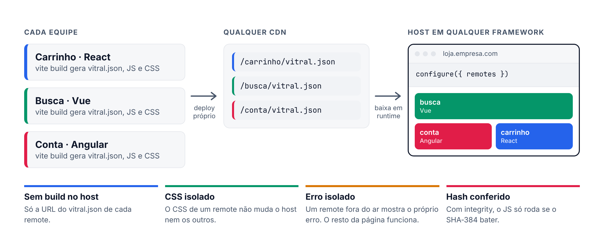

<p align="center">
  <picture>
    <source media="(prefers-color-scheme: dark)" srcset="https://raw.githubusercontent.com/joaogabriel15/vitral/main/docs/public/marca/banner-escuro.png">
    
  </picture>
</p>

<p align="center">
  <a href="https://github.com/joaogabriel15/vitral/actions/workflows/ci.yml"></a>
  <a href="https://www.npmjs.com/package/vitral"></a>
  <a href="https://bundlejs.com/?q=vitral"></a>
  <a href="https://github.com/joaogabriel15/vitral/blob/main/LICENSE"></a>
</p>

<p align="center">
  <a href="https://joaogabriel15.github.io/vitral/">Documentação</a> ·
  <a href="https://joaogabriel15.github.io/vitral/aprender/configurar">Começar</a> ·
  <a href="https://joaogabriel15.github.io/vitral/por-que">Por que o vitral</a> ·
  <a href="https://joaogabriel15.github.io/vitral/aprender/benchmark">Benchmark</a> ·
  <a href="./README.en.md">English</a>
</p>

Junte micro-frontends de qualquer framework numa página só, sem configuração de build no host.

Cada equipe publica o próprio pedaço da página (um remote) com `vite build`. O host recebe a URL de cada remote e monta tudo no navegador.

**Por que usar:**

- **Zero configuração no host.** Sem plugin de build: só `configure({ remotes })` com a URL de cada remote.
- **Qualquer framework.** React, Next, Vue, Nuxt, Angular, Svelte, Solid, Preact, Lit e JS puro na mesma página. Sem combinar versão de React entre equipes.
- **Deploy independente.** Cada equipe publica quando quiser. O host vê a versão nova sem novo build.
- **CSS e erros isolados.** O CSS de um remote não muda o resto da página. Um remote fora do ar mostra o próprio erro, e o resto continua funcionando.
- **Seguro.** O JS só roda se vier de uma origem permitida e se o hash SHA-384 bater.
- **Leve e rápido.** 5,1 kB de host. Abre a página na metade do tempo do Module Federation e troca de área 4,5 vezes mais rápido que o Next.js Multi-Zones.

```bash
npm install vitral
```

<p align="center">
  <picture>
    <source media="(prefers-color-scheme: dark)" srcset="https://raw.githubusercontent.com/joaogabriel15/vitral/main/docs/public/marca/como-funciona-escuro.png">
    
  </picture>
</p>

## Comparação

| | Module Federation | single-spa | Next.js Multi-Zones | vitral |
|---|---|---|---|---|
| Configuração no host | Plugin no build, combinado com cada remote | Root config e import map | Um app Next por zona e rewrites | Nenhuma. Só `configure()` |
| Frameworks | Combinar versões em `shared` | Um adaptador e um ciclo de vida por framework | Só Next | Qualquer um, sem combinar versão |
| Divide a página em | Pedaços | Apps por rota | Rotas (cada zona é uma página) | Pedaços ou rotas |
| Trocar de área | Sem recarregar | Sem recarregar | Recarrega a página e baixa Next e React de novo | Sem recarregar |
| Isolamento de CSS | Nenhum | Nenhum | Por página | Escopo automático ou Shadow DOM |
| Remote fora do ar | Erro sem tratamento derruba a página | A tela de erro é com você | A zona inteira fica fora | Só aquele remote mostra erro, com `retry` |
| Código de host (brotli) | 19,4 kB | 5,8 kB | Runtime do Next em cada zona | 5,1 kB |

## Velocidade

Medido no Chromium com rede de celular lenta (Slow 4G). Mediana de 7 visitas. Menor é melhor.

**Contra o Module Federation**, com o React compartilhado entre os remotes:

| | vitral | Module Federation |
|---|--:|--:|
| Abrir a página com 1 remote | **1,1 s** | 2,6 s |
| Abrir a página com 8 remotes | **2,1 s** | 4,5 s |
| Baixado com 8 remotes | **153 kB** | 409 kB |

**Contra o Next.js Multi-Zones**, com o app dividido em duas áreas:

| | vitral | Multi-Zones |
|---|--:|--:|
| Abrir a primeira área | **0,7 s** | 1,0 s |
| Trocar de área | **0,2 s** | 0,8 s |
| Baixado para abrir as duas áreas | **83 kB** | 229 kB |

[Como foi medido](https://joaogabriel15.github.io/vitral/aprender/benchmark): versões, máquina e o script para rodar de novo.

Os 10 frameworks têm testes de ponta a ponta no CI, com host e remote de frameworks diferentes, em Chromium, Firefox, WebKit e mobile.

## Começo rápido

Para gerar host e remote prontos: `npm create vitral@latest`.

**1. No remote**, exporte o componente e use o plugin:

```jsx
// src/App.jsx (ou .vue, .svelte, .tsx…)
export default function Carrinho({ userId }) { … }
```

```js
// vite.config.js
import react from '@vitejs/plugin-react'
import vitral from 'vitral/vite'

export default { plugins: [react(), vitral()] }
```

O plugin descobre o framework e embrulha o `export default` com o adaptador certo. A entrada padrão é `src/remote.*` ou `src/App.*`.

`vite build` gera o JS, o CSS e um `vitral.json`. Publique a pasta `dist` em qualquer CDN com CORS.

**2. No host**, registre a URL e use o componente:

```jsx
import { configure } from 'vitral'
import { Remote } from 'vitral/react'

configure({
  remotes: { carrinho: 'https://cdn.empresa.com/carrinho/vitral.json' },
})

export function App() {
  return (
    <Remote
      name="carrinho"
      props={{ userId: 42 }}
      fallback={<p>Carregando…</p>}
      error={(erro, tentarDeNovo) => <button onClick={tentarDeNovo}>Tentar de novo</button>}
    />
  )
}
```

Pronto. Mudar `props` atualiza o remote sem remontar.

Sem build no host, numa página HTML qualquer:

```html
<script type="module" src="https://cdn.jsdelivr.net/npm/vitral/dist/auto.js"></script>
<vitral-remote src="https://cdn.empresa.com/carrinho/vitral.json"></vitral-remote>
```

Todos os componentes de host aceitam `src` no lugar de `name`.

## Next.js e Nuxt como host

O remote é sempre um projeto Vite (React, Vue ou outro), como no Começo rápido acima. O host pode ser um app Next ou Nuxt.

**Next.js (App Router):**

```tsx
// app/carrinho.tsx
'use client'
import { configure } from 'vitral'
import { Remote } from 'vitral/react'

if (typeof window !== 'undefined') {
  configure({ remotes: { carrinho: 'https://cdn.empresa.com/carrinho/vitral.json' } })
}

export function Carrinho({ userId }: { userId: number }) {
  return <Remote name="carrinho" props={{ userId }} fallback={<p>Carregando…</p>} />
}
```

```tsx
// app/page.tsx
import { Carrinho } from './carrinho'

export default function Page() {
  return <main><Carrinho userId={42} /></main>
}
```

**Nuxt 3 e 4:**

```ts
// app/plugins/vitral.client.ts
import { configure } from 'vitral'

export default defineNuxtPlugin(() => {
  configure({ remotes: { catalogo: 'https://cdn.empresa.com/catalogo/vitral.json' } })
})
```

```vue
<!-- app/pages/index.vue -->
<script setup lang="ts">
import { VitralRemote } from 'vitral/vue'
</script>

<template>
  <VitralRemote name="catalogo" :props="{ userId: 42 }">
    <template #fallback><p>Carregando…</p></template>
  </VitralRemote>
</template>
```

Nos dois, o servidor renderiza o `fallback` e o remote monta no navegador. Não precisa de `dynamic(..., { ssr: false })` nem de `<ClientOnly>`.

## Multi-Zones ou vitral

O mesmo app Next dividido em duas áreas: a loja (app principal) e a conta, de outra equipe.

**Com Multi-Zones**, a conta é um segundo app Next, e o app principal repassa as URLs para ele:

```js
// conta/next.config.js (a zona)
module.exports = {
  basePath: '/conta',
  assetPrefix: '/conta-static',
}
```

```js
// loja/next.config.js (o app principal)
module.exports = {
  async rewrites() {
    return [
      { source: '/conta', destination: `${process.env.CONTA_URL}/conta` },
      { source: '/conta/:path+', destination: `${process.env.CONTA_URL}/conta/:path+` },
      { source: '/conta-static/:path+', destination: `${process.env.CONTA_URL}/conta-static/:path+` },
    ]
  },
}
```

```tsx
// links entre zonas: <a>, não <Link>. A página recarrega e baixa Next e React de novo.
<a href="/conta">Minha conta</a>
```

**Com vitral**, a conta é um remote (projeto Vite) e a loja continua sendo o único app Next:

```js
// conta/vite.config.js (o remote)
import react from '@vitejs/plugin-react'
import vitral from 'vitral/vite'

export default { plugins: [react(), vitral({ name: 'conta', dedupe: ['react'] })] }
```

```js
// loja/next.config.js (o host)
const { withVitral } = require('vitral/next-config')

module.exports = withVitral({}, {
  remotes: {
    conta: { url: 'https://cdn.empresa.com/conta/vitral.json', basePath: '/conta' },
  },
})
```

```tsx
// loja/pages/_app.tsx
import { VitralNext } from 'vitral/next-host'

export default function App({ Component, pageProps }) {
  return <><VitralNext /><Component {...pageProps} /></>
}
```

```tsx
// loja/pages/conta/[[...slug]].tsx
import { NextRemote } from 'vitral/next-host'

export default function Conta() {
  return <Layout><NextRemote name="conta" fallback={<p>Carregando…</p>} /></Layout>
}
```

```tsx
// links: <Link> normal. A troca é sem recarregar, e o React não baixa de novo.
<Link href="/conta">Minha conta</Link>
```

| | Multi-Zones | vitral |
|---|---|---|
| Apps Next | Um por área | Só o host |
| Configuração | `basePath` e `assetPrefix` na zona, `rewrites` no app principal | `withVitral` no host, plugin no remote |
| Trocar de área | Recarrega a página (0,8 s no benchmark) | Sem recarregar (0,2 s) |
| React e Next | Baixados de novo em cada área | Uma cópia para a página toda |
| Layout do app principal | Cada zona repete o seu | O remote fica dentro do layout do host |

Guia completo, com SSR por rota e prefetch: [Migrar do Next.js Multi-Zones](https://joaogabriel15.github.io/vitral/migracao/multi-zones).

## Rodar local

Cada remote roda no próprio `vite dev`, numa porta. O host aponta para essas portas:

```bash
cd carrinho && npm run dev   # vite --port 5174
cd busca && npm run dev      # vite --port 5175
cd loja && npm run dev       # vite --port 3000
```

```json
// loja/public/remotes.json
{
  "carrinho": "http://localhost:5174/vitral.json",
  "busca": "http://localhost:5175/vitral.json"
}
```

```js
// loja/src/main.jsx
configure({ remotes: '/remotes.json' })
```

Editar o remote atualiza o host sem recarregar a página (HMR). Para rodar só um remote local e pegar os outros de homologação, abra o host com `?vitral=carrinho@http://localhost:5174`.

## Docker e Kubernetes

Cada remote vira uma imagem nginx com o `dist`. O host lê a lista de remotes de uma variável de ambiente quando o contêiner sobe, então a mesma imagem serve em qualquer ambiente.

```yaml
# compose.yaml
services:
  loja:                # host: http://localhost:8080
    build: ./loja
    ports: ["8080:80"]
    environment:
      VITRAL_REMOTES: '{"carrinho":"/mf/carrinho/vitral.json","busca":"/mf/busca/vitral.json"}'
  carrinho:            # remote React
    build: ./carrinho
  busca:               # remote Vue
    build: ./busca
```

O nginx do host repassa `/mf/carrinho/` para o contêiner `carrinho`. Tudo fica na mesma origem: sem CORS e com uma porta só. Parar o contêiner `carrinho` mostra o erro só no lugar do carrinho.

No Kubernetes, as mesmas imagens funcionam com um Service por remote; o Ingress pode fazer o papel do nginx do host. Se os remotes ficam num CDN, troque `VITRAL_REMOTES` pelas URLs do CDN.

Exemplo completo, com Dockerfiles e configuração do nginx: [`examples/docker`](https://github.com/joaogabriel15/vitral/tree/main/examples/docker).

## Frameworks

| Framework | Remote | Host | Import |
|---|---|---|---|
| React 18/19 | `reactRemote(App)` | `<Remote>` | `vitral/react` |
| Next.js (App e Pages Router) | `reactRemote(App)` | `<Remote>` | `vitral/react` |
| Vue 3 | `vueRemote(App, { setup })` | `<VitralRemote>` | `vitral/vue` |
| Nuxt 3/4 | `vueRemote(App, { setup })` | `<VitralRemote>` | `vitral/vue` |
| Angular 17+ | `angularRemote(Component, { providers })` | `<vitral-remote>` + `provideVitral()` | `vitral/angular` |
| Svelte 5 | `svelteRemote(App)` | `use:remote` | `vitral/svelte` |
| Solid | `solidRemote(App)` | `<Remote>` | `vitral/solid` |
| Preact | `preactRemote(App)` | `<Remote>` | `vitral/preact` |
| Lit e Web Components | `elementRemote('meu-widget')` | `<vitral-remote>` | `vitral/element` |
| JS e TypeScript puro | `component({ render })` | `<vitral-remote>` | `vitral` |

No Next e no Nuxt o componente renderiza o `fallback` no servidor e monta o remote no cliente.

Uma zona do Multi-Zones vira remote sem reescrever o código Next (`vitral({ next: true })`), e o app Next principal vira host com `withVitral` e `<NextRemote>`, trocando de área sem recarregar. Veja [Next.js](https://joaogabriel15.github.io/vitral/frameworks/next).

### Host em Vue

```vue
<script setup>
import { VitralRemote } from 'vitral/vue'
</script>

<template>
  <VitralRemote name="carrinho" :props="{ userId: 42 }">
    <template #fallback>Carregando…</template>
    <template #error="{ retry }"><button @click="retry">Tentar de novo</button></template>
  </VitralRemote>
</template>
```

### Host em qualquer outro lugar

`<vitral-remote>` funciona em HTML puro, Angular, Svelte, Astro ou HTML gerado no servidor:

```html
<script type="module">
  import { configure } from 'vitral'
  import { defineVitralElement } from 'vitral/element'

  configure({ remotes: { carrinho: 'https://cdn.empresa.com/carrinho/vitral.json' } })
  defineVitralElement()
</script>

<vitral-remote name="carrinho" props='{"userId": 42}'>
  <p slot="fallback">Carregando…</p>
  <p slot="error">Indisponível</p>
</vitral-remote>
```

### Remote sem framework

```ts
import { component, html } from 'vitral'

export default component<{ nome: string }>({
  state: { cliques: 0 },
  render: ({ nome }, state) => html`
    <p>Olá, ${nome}</p>
    <button onclick=${() => state.cliques++}>cliques: ${state.cliques}</button>
  `,
})
```

O que entra em `${}` é escapado. Mudar `state` ou as props atualiza a tela.

## Desenvolvimento

- **HMR:** com o remote em `vite dev`, aponte o host para `http://localhost:5174/vitral.json`. Editar o remote atualiza o host sem recarregar a página.
- **Overrides:** `http://localhost:3000/?vitral=carrinho@http://localhost:5174` troca a URL de um remote sem mexer no host. Só vale em `localhost` ou com `configure({ devOverrides: true })`. Para guardar no navegador, use `devtools()` de `vitral/devtools`.
- **Tipos das props:** o build publica `vitral.d.ts`. No host, `npx vitral types` gera `vitral-env.d.ts`, e uma prop errada passa a não compilar.

## Comunicação entre remotes

```js
import { events } from 'vitral'

events.emit('carrinho:total', 120)
const parar = events.on('carrinho:total', (total) => console.log(total))
events.last('carrinho:total') // 120
```

Todos os remotes usam o mesmo barramento. O que um remote assina é cancelado quando ele desmonta.

Para estado comum (usuário, tema, carrinho), use o contexto compartilhado:

```js
import { provide, shared } from 'vitral'

provide('usuario', { id: 42 })                    // host: cria e é o dono
provide('tema', 'claro', { writable: false })     // só o dono altera
shared('tema').subscribe((tema) => console.log(tema))
const nome = useShared('usuario', (u) => u?.nome) // React, Preact, Vue e Solid
```

Angular usa `injectShared`, Svelte usa `$tema` e Lit usa `SharedController`. Detalhes em [Contexto compartilhado](https://joaogabriel15.github.io/vitral/aprender/contexto).

Para mudar de página de dentro de um remote, use `navigate('/pedidos/42')`. Todos os roteadores da página recebem a mudança.

## CSS e Tailwind

Use Tailwind ou qualquer CSS no remote. O plugin prefixa o CSS para valer só dentro do remote, então o CSS de um remote não muda o host nem os outros remotes.

Para isolar por completo, use Shadow DOM:

```jsx
<Remote name="carrinho" isolate="shadow" />
```

Com Shadow DOM, as regras `@property` e `@font-face` sobem para o documento, então sombras, rings, gradientes e fontes do Tailwind v4 funcionam. O plugin já faz essa separação no build (campo `shadow` do `vitral.json`): a página só adota o CSS pronto. Manifestos antigos continuam funcionando, com a separação feita no navegador.

O remote também pode usar o tema do host:

```js
vitral({ theme: 'host' })                                  // var(--x) usa o valor do host, se existir
configure({ styles: { inherit: ['/assets/base.css'] } })   // CSS base do host dentro do Shadow DOM
```

Tema com Tailwind v4, dark mode, CSS legado e Tailwind v3 no host: [Estilos](https://joaogabriel15.github.io/vitral/aprender/estilos).

## Configuração

```js
configure({
  remotes: '/remotes.json',                    // ou { nome: url }
  allowedOrigins: ['https://cdn.empresa.com'], // padrão: a página e as origens registradas
  timeout: 15000,                              // ms por download
  retries: 1,                                  // novas tentativas em erro de rede
  isolate: 'none',                             // ou 'shadow'
})
```

Cada remote também aceita um objeto:

```js
configure({
  remotes: {
    carrinho: { url: 'https://cdn.empresa.com/carrinho/vitral.json', integrity: 'sha384-…' },
    menu: { module: () => import('./menu') }, // remote local, sem rede
  },
})
```

## Erros

Todo erro é um `RemoteError` com `code`, o nome do remote e `docs`, o link da [página do erro](https://github.com/joaogabriel15/vitral/tree/main/docs/erros) com causas e correção. Um remote que falha mostra o próprio erro e não derruba a página. `retry` monta só aquele remote de novo.

| `code` | Quando |
|---|---|
| `NOT_REGISTERED` | Nome não registrado em `configure` |
| `ORIGIN_BLOCKED` | URL fora de `allowedOrigins` |
| `TIMEOUT` | Não respondeu dentro de `timeout` |
| `INTEGRITY` | O hash do JS não confere |
| `INVALID_MODULE` | O arquivo não exporta `mount()` |
| `LOAD_FAILED` | Erro de rede ou HTTP |
| `MOUNT_FAILED` | O remote lançou erro ao montar |
| `RENDER_FAILED` | O remote quebrou depois de montado |

## Performance

Remote com `import()` também gera `dist/split/`: o navegador baixa só o que o remote usa ao abrir, e o resto chega no `import()`, conferido pelo mesmo hash. Hosts antigos continuam usando o arquivo único.

No CDN, sirva `vitral.json` com `Cache-Control: no-cache` e o resto (nome com hash) com `public, max-age=31536000, immutable`.


Assim que o manifesto chega, o JS e o CSS do remote baixam juntos. A montagem
espera os dois, para o remote não aparecer sem estilo. `configure()` abre a
conexão com a origem de cada remote (`<link rel="preconnect">`).

```js
import { preload } from 'vitral'
// Baixa JS e CSS sem montar, por exemplo no hover de um link
link.addEventListener('pointerenter', () => preload('checkout'), { once: true })
```

Nos componentes de host e no `<vitral-remote>`:

```html
<!-- monta perto de aparecer na tela; reserve o espaço para a página não pular -->
<vitral-remote name="comentarios" loading="lazy" style="display:block;min-height:400px"></vitral-remote>
<!-- monta com o navegador ocioso, mas já baixa no hover -->
<vitral-remote name="checkout" loading="idle" prefetch="hover"></vitral-remote>
<!-- remote que aparece logo ao abrir a página -->
<vitral-remote name="cabecalho" priority="high"></vitral-remote>
```

```jsx
<Remote name="checkout" loading="lazy" prefetch="visible" keepAlive />
```

| Opção | Valores | O que faz |
| --- | --- | --- |
| `loading` | `lazy`, `idle` | Monta a 200px de aparecer na tela, ou com o navegador ocioso |
| `prefetch` | `hover`, `visible`, `idle` | Chama `preload()` antes de montar |
| `priority` | `high` | `fetchpriority` alto no manifesto, no JS e no CSS |
| `keepAlive` (`keep-alive`) | `true` ou o máximo | Ao sair da página, o remote vai para um contêiner oculto (LRU, padrão 5); na volta só recebe as props novas |

Com keep-alive, o remote pode pausar timers e assinaturas:

```js
mount(el, props, ctx) {
  ctx.onDeactivate?.(() => clearInterval(timer))
  ctx.onActivate?.(() => (timer = setInterval(tick, 1000)))
}
```

### Métricas

Cada etapa do carregamento vira um `performance.measure` com o nome
`vitral:<remote>:<etapa>`. As etapas são `manifest`, `js`, `css` e `mount`.
Elas aparecem na aba Performance do DevTools. Para mandar ao seu RUM:

```js
configure({
  onMetric: ({ name, stage, duration }) => rum.send(`vitral.${stage}`, duration, { remote: name }),
})
```

O evento `vitral-ready` (e o `ready` do componente Vue) traz os tempos em
`detail.timings`, por exemplo `{ manifest: 12.3, js: 40.1, css: 8, mount: 2.4 }`.
Um remote local (`module`) só mede `css` e `mount`. Erros dentro do
`onMetric` são ignorados.

## Dependências compartilhadas

Para não baixar React ou Vue mais de uma vez, liste-os em `dedupe` no remote:

```js
vitral({ dedupe: ['react'] })
```

O remote usa a cópia que já está na página quando a versão serve (padrão: `^` da versão instalada no remote) e baixa a própria só quando não serve. Os componentes de host em React oferecem o React do host sem configuração.

### Mais formas de usar

Vários componentes por remote (`<Remote name="carrinho/MiniCarrinho" />`),
módulos sem UI (`loadModule('carrinho/api')`), deploy novo sem recarregar a
página (`watchUpdates()` e `refresh('carrinho')`) e app shell por rota
(`routes()` e `<vitral-outlet>`, em `vitral/routes`). Veja
[Exposes](https://joaogabriel15.github.io/vitral/aprender/exposes), [Atualização sem reload](https://joaogabriel15.github.io/vitral/aprender/atualizacoes) e [Rotas](https://joaogabriel15.github.io/vitral/aprender/rotas).

## Segurança

- Só importa JS de origens permitidas, mesmo que o `vitral.json` aponte para outra. O `src` de um componente de host entra na allowlist; o atributo `src` do `<vitral-remote>` não entra quando há `allowedOrigins`.
- Com `integrity`, nada roda sem o hash conferir. A lib usa o primeiro caminho que o navegador garante: import map com `integrity` (Chrome 133+, Safari 18.4+), `<link rel="modulepreload" integrity>` (Firefox 115+) ou, nos outros, baixa, confere e executa exatamente os bytes conferidos via `blob:`. Aceita `sha256`, `sha384` e `sha512`, e vários hashes separados por espaço (vale o mais forte). O CSS do manifesto também é conferido.
- Com CSP, a lib copia o `nonce` de um `<script nonce>` da página para o import map. Sem nonce, cai para o `modulepreload`.
- O hash só protege contra CDN comprometido se vier de outro lugar: fixe `integrity` no host ou embuta o manifesto (`{ url, manifest }`).
- Sem `eval` e sem iframes.
- Shadow DOM isola o CSS, não o JS. Para código de terceiros em que você não confia, use iframe.

## Testes do host

```ts
import { mockRemote, failingRemote } from 'vitral/testing'

const carrinho = mockRemote('carrinho', (el, props) => (el.textContent = `itens: ${props.itens}`))
// renderize o host
expect(carrinho.lastProps).toEqual({ itens: 2 })

failingRemote('recomendacoes') // testa a tela de erro
```

## Links

- [Exemplos](https://github.com/joaogabriel15/vitral/tree/main/examples): o mesmo remote em 8 frameworks e 9 hosts.
- [Como contribuir](https://github.com/joaogabriel15/vitral/blob/main/CONTRIBUTING.md)
- Licença [MIT](https://github.com/joaogabriel15/vitral/blob/main/LICENSE). Feito por [Pacheco Codes](https://pacheco.dev.br/).
