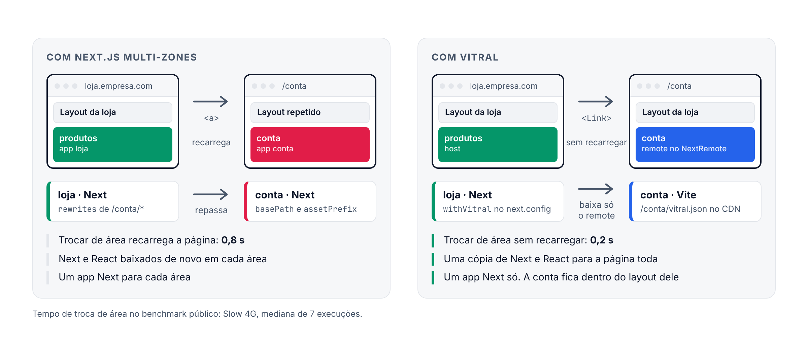
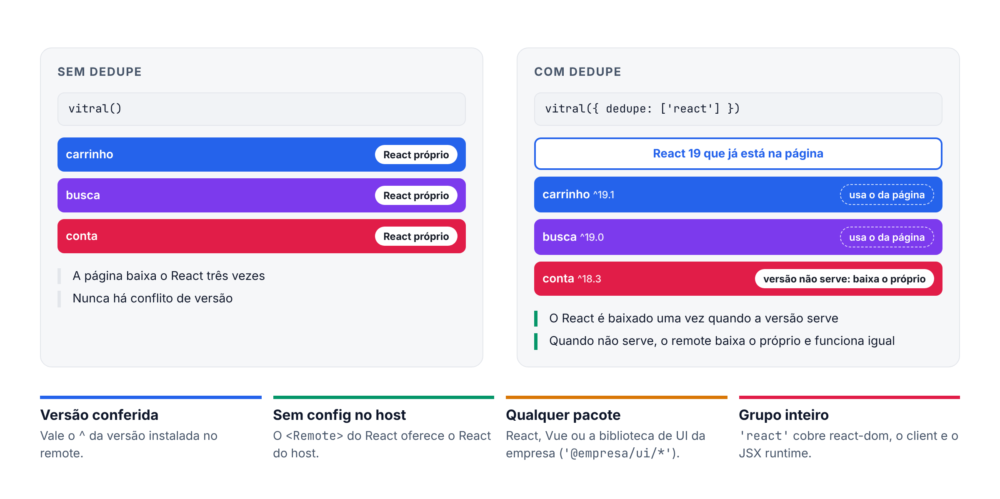
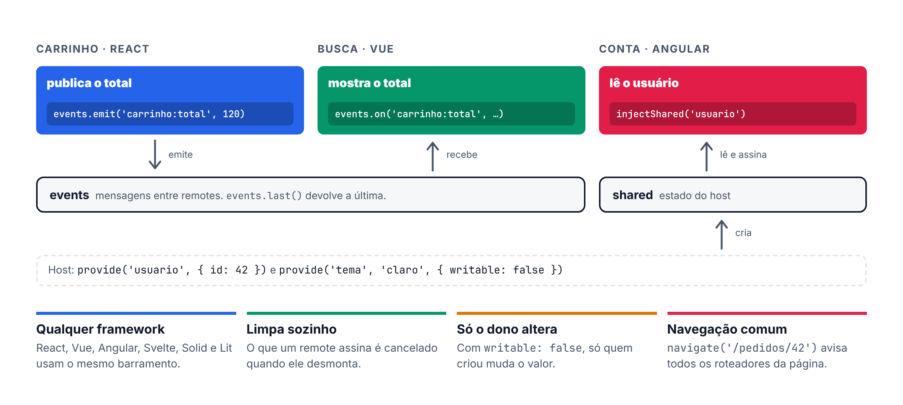
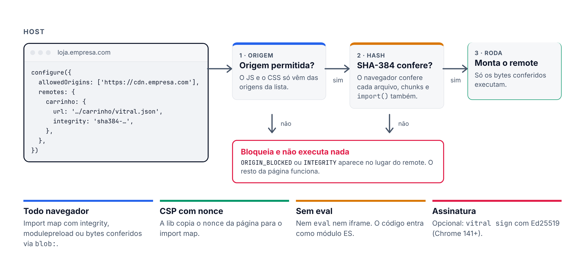

<p align="center">
  <picture>
    <source media="(prefers-color-scheme: dark)" srcset="https://raw.githubusercontent.com/joaogabriel15/vitral/main/docs/public/marca/banner-escuro.png">
    
  </picture>
</p>

<p align="center">
  <a href="https://github.com/joaogabriel15/vitral/actions/workflows/ci.yml"></a>
  <a href="https://www.npmjs.com/package/vitral"></a>
  <a href="https://bundlejs.com/?q=vitral"></a>
  <a href="https://github.com/joaogabriel15/vitral/blob/main/LICENSE"></a>
</p>

<p align="center">
  <a href="https://joaogabriel15.github.io/vitral/">Documentação</a> ·
  <a href="https://joaogabriel15.github.io/vitral/aprender/configurar">Começar</a> ·
  <a href="https://joaogabriel15.github.io/vitral/por-que">Por que o vitral</a> ·
  <a href="https://joaogabriel15.github.io/vitral/aprender/benchmark">Benchmark</a> ·
  <a href="./README.en.md">English</a>
</p>

Micro-frontends com qualquer framework, sem configurar build no host. React, Next.js, Vue, Nuxt, Angular, Svelte e outros na mesma página.

**O que é:** um micro-frontend é um pedaço da página que uma equipe constrói e publica sozinha, como o carrinho, a busca ou a área do cliente. O vitral junta esses pedaços numa página só, mesmo que cada um use um framework diferente.

**Como funciona:** cada equipe gera o seu pedaço (um *remote*) com `vite build` e publica num CDN. A página principal (o *host*) recebe a URL de cada remote e monta tudo no navegador.

**Por que usar:**

- **Zero configuração no host.** Sem plugin de build: só `configure({ remotes })` com a URL de cada remote.
- **Qualquer framework.** React, Next, Vue, Nuxt, Angular, Svelte, Solid, Preact, Lit e JS puro na mesma página. Sem combinar versão de React entre equipes.
- **Deploy independente.** Cada equipe publica quando quiser. O host vê a versão nova sem novo build.
- **CSS e erros isolados.** O CSS de um remote não muda o resto da página. Um remote fora do ar mostra o próprio erro, e o resto continua funcionando.
- **Seguro.** O JS só roda se vier de uma origem permitida e se o hash SHA-384 bater.
- **Leve e rápido.** 5,1 kB de host. Abre a página na metade do tempo do Module Federation e troca de área 4,5 vezes mais rápido que o Next.js Multi-Zones.

**Quando usar:** quando várias equipes mexem no mesmo site e cada uma quer publicar no próprio ritmo. Com uma equipe e um app só, um bundle comum é mais simples.

```bash
npm install vitral
```

<p align="center">
  <picture>
    <source media="(prefers-color-scheme: dark)" srcset="https://raw.githubusercontent.com/joaogabriel15/vitral/main/docs/public/marca/como-funciona-escuro.png">
    
  </picture>
</p>

## Comparação

| | Module Federation | single-spa | Next.js Multi-Zones | vitral |
|---|---|---|---|---|
| Configuração no host | Plugin no build, combinado com cada remote | Root config e import map | Um app Next por zona e rewrites | Nenhuma. Só `configure()` |
| Frameworks | Combinar versões em `shared` | Um adaptador e um ciclo de vida por framework | Só Next | Qualquer um, sem combinar versão |
| Divide a página em | Pedaços | Apps por rota | Rotas (cada zona é uma página) | Pedaços ou rotas |
| Trocar de área | Sem recarregar | Sem recarregar | Recarrega a página e baixa Next e React de novo | Sem recarregar |
| Isolamento de CSS | Nenhum | Nenhum | Por página | Escopo automático ou Shadow DOM |
| Remote fora do ar | Erro sem tratamento derruba a página | A tela de erro é com você | A zona inteira fica fora | Só aquele remote mostra erro, com `retry` |
| Código de host (brotli) | 19,4 kB | 5,8 kB | Runtime do Next em cada zona | 5,1 kB |

## Velocidade

Medido no Chromium com rede de celular lenta (Slow 4G). Mediana de 7 visitas. Menor é melhor.

**Contra o Module Federation**, com o React compartilhado entre os remotes:

| | vitral | Module Federation |
|---|--:|--:|
| Abrir a página com 1 remote | **1,1 s** | 2,6 s |
| Abrir a página com 8 remotes | **2,1 s** | 4,5 s |
| Baixado com 8 remotes | **153 kB** | 409 kB |

**Contra o Next.js Multi-Zones**, com o app dividido em duas áreas:

| | vitral | Multi-Zones |
|---|--:|--:|
| Abrir a primeira área | **0,7 s** | 1,0 s |
| Trocar de área | **0,2 s** | 0,8 s |
| Baixado para abrir as duas áreas | **83 kB** | 229 kB |

[Como foi medido](https://joaogabriel15.github.io/vitral/aprender/benchmark): versões, máquina e o script para rodar de novo.

Os 10 frameworks têm testes de ponta a ponta no CI, com host e remote de frameworks diferentes, em Chromium, Firefox, WebKit e mobile.

## Começo rápido

Para gerar host e remote prontos: `npm create vitral@latest`.

**1. No remote**, exporte o componente e ligue o plugin:

```jsx
// src/App.jsx (ou .vue, .svelte, .tsx…)
export default function Carrinho({ userId }) { … }
```

```js
// vite.config.js
import react from '@vitejs/plugin-react'
import vitral from 'vitral/vite'

export default { plugins: [react(), vitral()] }
```

`vite build` gera o JS, o CSS e um `vitral.json`. Publique a pasta `dist` em qualquer CDN.

**2. No host**, registre a URL e mostre o remote:

```jsx
import { configure } from 'vitral'
import { Remote } from 'vitral/react'

configure({ remotes: { carrinho: 'https://cdn.empresa.com/carrinho/vitral.json' } })

export function App() {
  return <Remote name="carrinho" props={{ userId: 42 }} fallback={<p>Carregando…</p>} />
}
```

Pronto. Mudar `props` atualiza o remote sem remontar.

Numa página HTML qualquer, sem build:

```html
<script type="module" src="https://cdn.jsdelivr.net/npm/vitral/dist/auto.js"></script>
<vitral-remote src="https://cdn.empresa.com/carrinho/vitral.json"></vitral-remote>
```

## Frameworks

| Framework | Remote | Host | Import |
|---|---|---|---|
| React 18/19 | `reactRemote(App)` | `<Remote>` | `vitral/react` |
| Next.js (App e Pages Router) | `reactRemote(App)` | `<Remote>` | `vitral/react` |
| Vue 3 | `vueRemote(App, { setup })` | `<VitralRemote>` | `vitral/vue` |
| Nuxt 3/4 | `vueRemote(App, { setup })` | `<VitralRemote>` | `vitral/vue` |
| Angular 17+ | `angularRemote(Component, { providers })` | `<vitral-remote>` + `provideVitral()` | `vitral/angular` |
| Svelte 5 | `svelteRemote(App)` | `use:remote` | `vitral/svelte` |
| Solid | `solidRemote(App)` | `<Remote>` | `vitral/solid` |
| Preact | `preactRemote(App)` | `<Remote>` | `vitral/preact` |
| Lit e Web Components | `elementRemote('meu-widget')` | `<vitral-remote>` | `vitral/element` |
| JS e TypeScript puro | `component({ render })` | `<vitral-remote>` | `vitral` |

Host e remote não precisam ser do mesmo framework. Cada um tem uma página com exemplo completo em [Frameworks](https://joaogabriel15.github.io/vitral/frameworks/react).

## Next.js e Nuxt como host

O remote é sempre um projeto Vite (React, Vue ou outro), como no Começo rápido acima. O host pode ser um app Next ou Nuxt.

**Next.js (App Router):**

```tsx
// app/carrinho.tsx
'use client'
import { configure } from 'vitral'
import { Remote } from 'vitral/react'

if (typeof window !== 'undefined') {
  configure({ remotes: { carrinho: 'https://cdn.empresa.com/carrinho/vitral.json' } })
}

export function Carrinho({ userId }: { userId: number }) {
  return <Remote name="carrinho" props={{ userId }} fallback={<p>Carregando…</p>} />
}
```

```tsx
// app/page.tsx
import { Carrinho } from './carrinho'

export default function Page() {
  return <main><Carrinho userId={42} /></main>
}
```

**Nuxt 3 e 4:**

```ts
// app/plugins/vitral.client.ts
import { configure } from 'vitral'

export default defineNuxtPlugin(() => {
  configure({ remotes: { catalogo: 'https://cdn.empresa.com/catalogo/vitral.json' } })
})
```

```vue
<!-- app/pages/index.vue -->
<script setup lang="ts">
import { VitralRemote } from 'vitral/vue'
</script>

<template>
  <VitralRemote name="catalogo" :props="{ userId: 42 }">
    <template #fallback><p>Carregando…</p></template>
  </VitralRemote>
</template>
```

Nos dois, o servidor renderiza o `fallback` e o remote monta no navegador. Não precisa de `dynamic(..., { ssr: false })` nem de `<ClientOnly>`.

## Multi-Zones ou vitral

Exemplo: uma loja em Next.js com a área "Minha conta", feita por outra equipe.

<p align="center">
  <picture>
    <source media="(prefers-color-scheme: dark)" srcset="https://raw.githubusercontent.com/joaogabriel15/vitral/main/docs/public/marca/multizonas-escuro.png">
    
  </picture>
</p>

### Hoje, com Multi-Zones

São dois apps Next. A loja repassa as URLs de `/conta` para o app da conta.

```
loja/    app Next principal
conta/   segundo app Next (a zona)
```

```js
// conta/next.config.js
module.exports = {
  basePath: '/conta',
  assetPrefix: '/conta-static',
}
```

```tsx
// conta/pages/index.tsx
export default function Conta() {
  return <h1>Minha conta</h1>
}
```

```js
// loja/next.config.js
module.exports = {
  async rewrites() {
    return [
      { source: '/conta', destination: `${process.env.CONTA_URL}/conta` },
      { source: '/conta/:path+', destination: `${process.env.CONTA_URL}/conta/:path+` },
      { source: '/conta-static/:path+', destination: `${process.env.CONTA_URL}/conta-static/:path+` },
    ]
  },
}
```

```tsx
// loja/components/Menu.tsx
// <a>, não <Link>: a página recarrega e baixa Next e React de novo.
<a href="/conta">Minha conta</a>
```

### O mesmo app com vitral

A loja continua sendo o único app Next. A conta vira um remote: um projeto Vite com o mesmo componente.

```
loja/    app Next (o host)
conta/   projeto Vite (o remote)
```

```js
// conta/vite.config.js (no lugar do next.config.js da zona)
import react from '@vitejs/plugin-react'
import vitral from 'vitral/vite'

export default { plugins: [react(), vitral({ name: 'conta', dedupe: ['react'] })] }
```

```tsx
// conta/src/App.tsx (o mesmo componente da página)
export default function Conta() {
  return <h1>Minha conta</h1>
}
```

```js
// loja/next.config.js (no lugar das rewrites)
const { withVitral } = require('vitral/next-config')

module.exports = withVitral({}, {
  remotes: {
    conta: { url: 'https://cdn.empresa.com/conta/vitral.json', basePath: '/conta' },
  },
})
```

```tsx
// loja/pages/_app.tsx (só acrescenta <VitralNext />)
import { VitralNext } from 'vitral/next-host'

export default function App({ Component, pageProps }) {
  return <><VitralNext /><Component {...pageProps} /></>
}
```

```tsx
// loja/pages/conta/[[...slug]].tsx (arquivo novo: a página que mostra a conta)
import { NextRemote } from 'vitral/next-host'

export default function Conta() {
  return <Layout><NextRemote name="conta" fallback={<p>Carregando…</p>} /></Layout>
}
```

```tsx
// loja/components/Menu.tsx
// <Link> normal: a troca é sem recarregar, e o React não baixa de novo.
<Link href="/conta">Minha conta</Link>
```

Se o código da conta já usa `next/link` ou `useRouter`, não precisa reescrever: `vitral({ name: 'conta', next: { basePath: '/conta' } })` builda esse código com o Vite.

### O que muda

| | Multi-Zones | vitral |
|---|---|---|
| Apps Next | Um por área | Só a loja |
| Configuração | `basePath` e `assetPrefix` na zona, `rewrites` na loja | `withVitral` na loja, plugin na conta |
| Trocar de área | Recarrega a página (0,8 s no benchmark) | Sem recarregar (0,2 s) |
| React e Next | Baixados de novo em cada área | Uma cópia para a página toda |
| Layout da loja | Cada zona repete o seu | A conta fica dentro do layout da loja |

Guia completo, com SSR por rota e prefetch: [Migrar do Next.js Multi-Zones](https://joaogabriel15.github.io/vitral/migracao/multi-zones).

## O que mais vem junto

**Dependências compartilhadas.** Com `vitral({ dedupe: ['react'] })`, o remote usa o React que já está na página e não baixa outra cópia. [Dedupe](https://joaogabriel15.github.io/vitral/aprender/dedupe)

<p align="center">
  <picture>
    <source media="(prefers-color-scheme: dark)" srcset="https://raw.githubusercontent.com/joaogabriel15/vitral/main/docs/public/marca/dedupe-escuro.png">
    
  </picture>
</p>

**Comunicação entre remotes.** `events` manda mensagens entre remotes, e `provide` e `shared` guardam estado comum, como o usuário logado. [Props e eventos](https://joaogabriel15.github.io/vitral/aprender/props-eventos) e [Contexto compartilhado](https://joaogabriel15.github.io/vitral/aprender/contexto)

<p align="center">
  <picture>
    <source media="(prefers-color-scheme: dark)" srcset="https://raw.githubusercontent.com/joaogabriel15/vitral/main/docs/public/marca/comunicacao-escuro.png">
    
  </picture>
</p>

**Segurança.** O JS só roda se vier de uma origem permitida e, com `integrity`, se o hash bater. [SRI e origens](https://joaogabriel15.github.io/vitral/aprender/seguranca)

<p align="center">
  <picture>
    <source media="(prefers-color-scheme: dark)" srcset="https://raw.githubusercontent.com/joaogabriel15/vitral/main/docs/public/marca/seguranca-escuro.png">
    
  </picture>
</p>

E também:

- **CSS e Tailwind:** o CSS de cada remote vale só dentro dele, ou use Shadow DOM com `isolate="shadow"`. [Estilos](https://joaogabriel15.github.io/vitral/aprender/estilos)
- **Carregamento:** `loading="lazy"`, `prefetch="hover"` e `keepAlive` para abrir e voltar mais rápido. [Carregamento](https://joaogabriel15.github.io/vitral/aprender/carregamento)
- **Erros:** cada erro tem um código e uma página com causa e correção, e `retry` monta só aquele remote de novo. [Erros](https://joaogabriel15.github.io/vitral/erros/)
- **Props tipadas:** `npx vitral types` faz uma prop errada não compilar no host. [Contratos](https://joaogabriel15.github.io/vitral/aprender/contratos)
- **Rotas, SSR e deploy:** app shell por rota, HTML do remote no servidor, canary e rollback. [Rotas](https://joaogabriel15.github.io/vitral/aprender/rotas), [SSR](https://joaogabriel15.github.io/vitral/aprender/ssr) e [Canary](https://joaogabriel15.github.io/vitral/aprender/canary)
- **Testes:** `mockRemote` e `failingRemote` testam o host sem rede. [Testes](https://joaogabriel15.github.io/vitral/aprender/testes)

## Rodar local e com Docker

Cada remote roda no próprio `vite dev`, numa porta, e o host aponta para essas portas:

```json
// loja/public/remotes.json
{
  "carrinho": "http://localhost:5174/vitral.json",
  "busca": "http://localhost:5175/vitral.json"
}
```

```js
// loja/src/main.jsx
configure({ remotes: '/remotes.json' })
```

Editar o remote atualiza o host sem recarregar a página. Com Docker, cada remote vira uma imagem nginx e o host lê a lista de remotes de uma variável de ambiente, então a mesma imagem serve em qualquer ambiente. [Local e Docker](https://joaogabriel15.github.io/vitral/aprender/local-e-docker) e o exemplo [`examples/docker`](https://github.com/joaogabriel15/vitral/tree/main/examples/docker).

## Links

- [Documentação](https://joaogabriel15.github.io/vitral/): guias, referência e páginas de erro.
- [Exemplos](https://github.com/joaogabriel15/vitral/tree/main/examples): o mesmo remote em 8 frameworks e 9 hosts.
- [Como contribuir](https://github.com/joaogabriel15/vitral/blob/main/CONTRIBUTING.md)
- Licença [MIT](https://github.com/joaogabriel15/vitral/blob/main/LICENSE). Feito por [Pacheco Codes](https://pacheco.dev.br/).
